<div align="center">

<table>
  <tr>
    <td align="center" width="140"></td>
    <td align="center">
      <b>Université Cheikh Anta Diop de Dakar</b><br>
      <b>École Supérieure Polytechnique</b><br>
      Département Génie Informatique<br>
      <sub>L3 GLSI — Services Réseaux Avancés</sub>
    </td>
    <td align="center" width="140"></td>
  </tr>
</table>

# 🔐 TP : Mise en place du protocole SSH

**Accès distant sécurisé, authentification par clés et tunnels SSH (HTTP & MariaDB)**


| Réalisé par | Sous la direction de | Année universitaire |
|:---:|:---:|:---:|
| **Moussa Ndioukh FAYE**<br>**Seynabou CISSE** | **Dr. GUEYE** | 2026 – 2027 |

</div>

---

## 📑 Sommaire

1. [Introduction](#1-introduction)
2. [Environnement de travail](#2-environnement-de-travail)
3. [Installation du serveur SSH](#3-installation-du-serveur-ssh)
4. [Connexion SSH depuis le client](#4-connexion-ssh-depuis-le-client)
5. [Configuration des clés SSH](#5-configuration-des-clés-ssh)
6. [Tunnel SSH en ligne de commande](#6-tunnel-ssh-en-ligne-de-commande)
7. [Conclusion](#7-conclusion)

---

## 1. Introduction

**SSH** (*Secure Shell*) est un protocole réseau qui permet d'administrer une machine à distance de manière sécurisée. Contrairement à Telnet, qui transmet les données (y compris les mots de passe) en clair, SSH **chiffre l'intégralité des échanges** entre le client et le serveur. Il fonctionne par défaut sur le **port TCP 22**, selon une architecture client/serveur : le démon `sshd` écoute côté serveur et le client `ssh` initie la connexion.

SSH propose deux modes d'authentification :

- **par mot de passe** : l'utilisateur saisit le mot de passe de son compte distant ;
- **par paire de clés asymétriques** : la clé privée reste secrète et la clé publique est déposée sur la machine distante, ce qui permet une connexion **sans mot de passe**.

SSH permet aussi de créer des **tunnels** (redirection de ports) pour faire transiter d'autres protocoles (HTTP, MySQL…) dans une connexion chiffrée.

> **🎯 Objectif du TP**
> Comprendre comment utiliser SSH pour sécuriser l'accès à une machine distante : installer et vérifier un serveur OpenSSH, s'y connecter depuis un client, mettre en place l'authentification par clés, puis créer des tunnels SSH vers un serveur web Apache et une base de données MariaDB.

---

## 2. Environnement de travail

| Élément | Serveur SSH | Client SSH |
|---|---|---|
| **Système** | Ubuntu Server 24.04.3 LTS | Windows (PowerShell 5.1) |
| **Nom d'hôte** | `seynabouuserver` | `HP` |
| **Utilisateur** | `seynabouu` | `HP` |
| **Adresse IP** | `192.168.1.20/24` | réseau `192.168.1.0/24` |
| **Logiciels** | OpenSSH Server, Apache2, MariaDB | Client OpenSSH, client MariaDB, navigateur |

```
 ┌──────────────────────┐        SSH chiffré (port 22)        ┌──────────────────────────┐
 │    Client Windows    │ ──────────────────────────────────▶ │      Serveur Ubuntu      │
 │  PowerShell : ssh    │                                     │      192.168.1.20        │
 │  navigateur, mysql   │ ─ ─ tunnels : 1024 → 80 (Apache) ─▶ │  sshd :22 · Apache :80   │
 │                      │ ─ ─           3307 → 3306 (MariaDB) │  MariaDB :3306           │
 └──────────────────────┘                                     └──────────────────────────┘
```

---

## 3. Installation du serveur SSH

### 3.1 Installation du paquet OpenSSH Server

Sur la machine serveur, on installe le paquet `openssh-server`, qui fournit le démon `sshd` :

```bash
sudo apt update
sudo apt install openssh-server
```

<p align="center">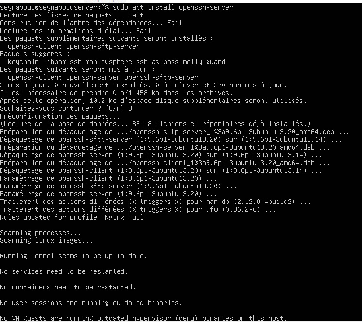</p>
<p align="center"><i>Figure 1 – Installation du paquet <code>openssh-server</code></i></p>

Le gestionnaire de paquets met à jour `openssh-server`, `openssh-client` et `openssh-sftp-server` vers la version `1:9.6p1-3ubuntu13.20`.

### 3.2 Activation et démarrage du service

On active le service pour qu'il démarre automatiquement au boot, on le lance, puis on vérifie son état :

```bash
sudo systemctl enable ssh
sudo systemctl start ssh
sudo systemctl status ssh
```

<p align="center">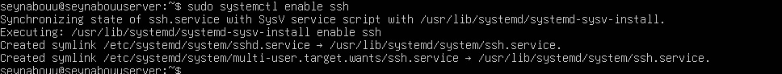</p>
<p align="center"><i>Figure 2 – Activation du service SSH au démarrage</i></p>

<p align="center">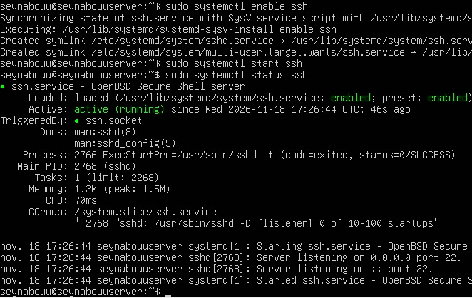</p>
<p align="center"><i>Figure 3 – Le service <code>ssh</code> est actif (<b>active (running)</b>)</i></p>

Le statut indique **active (running)** et les journaux confirment que `sshd` écoute sur `0.0.0.0` et `::` au **port 22**.

### 3.3 Vérification du port 22 et de l'adresse IP

```bash
ss -tlnp | grep :22
ip a
```

<p align="center">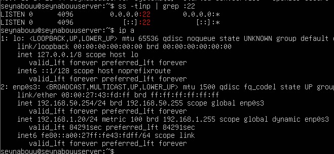</p>
<p align="center"><i>Figure 4 – Port 22 en écoute (IPv4 et IPv6) et adresse IP du serveur</i></p>

Le port 22 est à l'état `LISTEN`. L'interface `enp0s3` du serveur porte l'adresse **`192.168.1.20/24`**, que le client utilisera pour se connecter.

> **ℹ️ Remarque**
> Le TP utilise `netstat -anp | grep -w 22`. La commande `ss -tlnp` est son équivalent moderne : sur les distributions récentes, `netstat` (paquet `net-tools`) n'est plus installé par défaut.

---

## 4. Connexion SSH depuis le client

Depuis le client Windows, on ouvre PowerShell et on se connecte au serveur avec la syntaxe `ssh utilisateur@adresse_ip_du_serveur` :

```powershell
ssh seynabouu@192.168.1.20
```

<p align="center">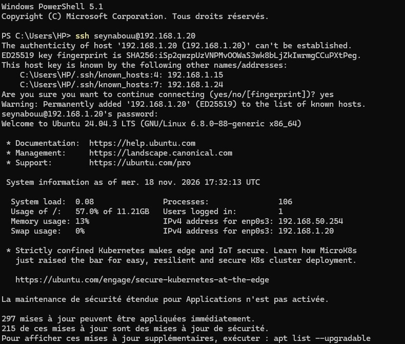</p>
<p align="center"><i>Figure 5 – Première connexion : vérification de l'empreinte du serveur</i></p>

Lors de la première connexion, le client ne connaît pas encore le serveur : il affiche l'**empreinte** de sa clé d'hôte ED25519 et demande confirmation. Après `yes`, l'adresse est enregistrée dans le fichier `known_hosts` du client, ce qui protège contre les attaques de type *homme du milieu* lors des connexions suivantes. Le mot de passe du compte distant est ensuite demandé.

<p align="center">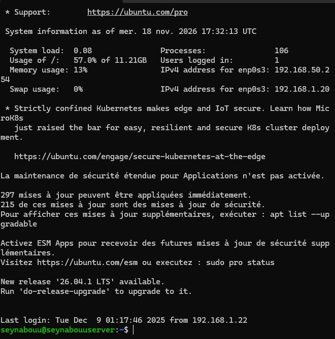</p>
<p align="center"><i>Figure 6 – Connexion établie : l'invite <code>seynabouu@seynabouuserver</code> apparaît</i></p>

La bannière d'Ubuntu 24.04.3 LTS s'affiche, suivie de l'invite du serveur : la session distante chiffrée est ouverte.

---

## 5. Configuration des clés SSH

### 5.1 Génération de la paire de clés

Sur le serveur, on génère une paire de clés RSA (3072 bits par défaut), sans phrase de passe :

```bash
ssh-keygen -t rsa
```

<p align="center">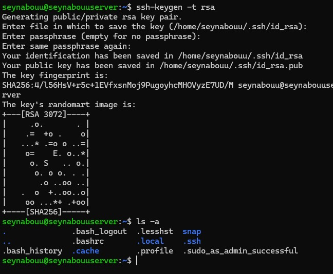</p>
<p align="center"><i>Figure 7 – Génération de la paire de clés RSA</i></p>

Deux fichiers sont créés dans `/home/seynabouu/.ssh/` :

- `id_rsa` : la **clé privée**, qui ne doit jamais quitter la machine ;
- `id_rsa.pub` : la **clé publique**, destinée à être copiée sur les machines distantes.

### 5.2 Vérification de la présence des fichiers

```bash
ls -a
cd .ssh/
ls
```

<p align="center">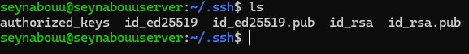</p>
<p align="center"><i>Figure 8 – Contenu du répertoire <code>~/.ssh</code></i></p>

Le répertoire caché `.ssh` contient bien `id_rsa` et `id_rsa.pub`, ainsi que le fichier `authorized_keys` et une paire ED25519 déjà présente.

### 5.3 Copie de la clé publique

La clé publique est transférée avec `scp` (copie de fichiers via SSH) :

```bash
scp id_rsa.pub seynabouu@192.168.1.20:/home/seynabouu
```

<p align="center">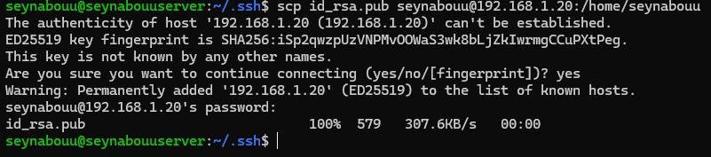</p>
<p align="center"><i>Figure 9 – Transfert de la clé publique avec <code>scp</code></i></p>

Le transfert s'effectue à 100 % (579 octets). Pour que la connexion se fasse sans mot de passe, la clé publique doit ensuite être ajoutée au fichier `authorized_keys` du compte de destination, avec des permissions restrictives :

```bash
cat ~/id_rsa.pub >> ~/.ssh/authorized_keys
chmod 700 ~/.ssh
chmod 600 ~/.ssh/authorized_keys
```

> **🔑 Principe de l'authentification par clé**
> Lors de la connexion, le serveur SSH de destination envoie un défi que seul le détenteur de la clé privée peut signer. Il vérifie la signature avec la clé publique présente dans `authorized_keys` : si elle est valide, l'accès est accordé sans mot de passe. La commande `ssh-copy-id utilisateur@ip` automatise la copie et l'ajout de la clé.

---

## 6. Tunnel SSH en ligne de commande

Un tunnel SSH (redirection de port locale, option `-L`) permet de faire transiter un autre protocole à l'intérieur de la connexion SSH chiffrée :

```bash
ssh -L port_local:hote_cible:port_cible utilisateur@serveur_ssh
```

Tout ce qui est envoyé sur `port_local` du client est chiffré, transporté par SSH jusqu'au serveur, puis remis à `hote_cible:port_cible` **du point de vue du serveur**.

### 6.1 Tunnel vers le serveur web Apache

Un serveur web Apache2 a d'abord été installé sur le serveur Ubuntu, avec une page d'accueil personnalisée :

```bash
sudo apt install apache2
sudo systemctl enable --now apache2
```

Depuis le client, on crée un tunnel qui associe le port local **1024** au port **80** du serveur :

```powershell
ssh -L 1024:127.0.0.1:80 seynabouu@192.168.1.20
```

En laissant cette session ouverte, on accède à la page web depuis un navigateur du client à l'adresse `http://localhost:1024` :

<p align="center">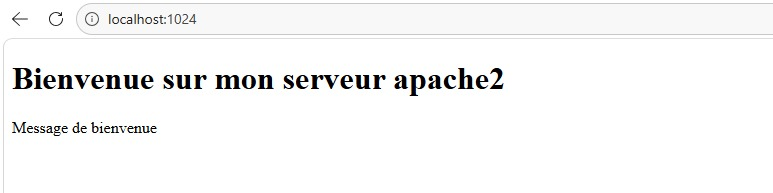</p>
<p align="center"><i>Figure 10 – Page Apache du serveur affichée via le tunnel (<code>localhost:1024</code>)</i></p>

La page « *Bienvenue sur mon serveur apache2* » hébergée sur le serveur s'affiche : la requête HTTP a transité de manière chiffrée dans le tunnel SSH.

### 6.2 Tunnel vers la base de données MariaDB

**Préparation du serveur.** On installe MariaDB, on active le service, puis on crée un utilisateur de test :

```bash
sudo apt install mariadb-server
sudo systemctl enable --now mariadb
sudo mariadb
```

```sql
CREATE USER 'tp'@'localhost' IDENTIFIED BY '*****';
GRANT ALL ON *.* TO 'tp'@'localhost';
FLUSH PRIVILEGES;
EXIT;
```

<p align="center">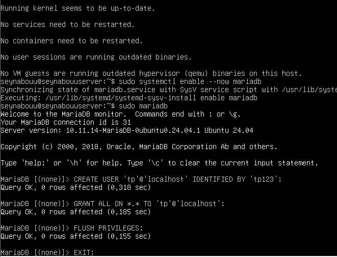</p>
<p align="center"><i>Figure 11 – Création de l'utilisateur <code>tp</code> dans MariaDB</i></p>

**Création du tunnel.** Depuis le client, on redirige le port local **3307** vers le port **3306** (MariaDB) du serveur :

```powershell
ssh -L 3307:127.0.0.1:3306 seynabouu@192.168.1.20
```

<p align="center">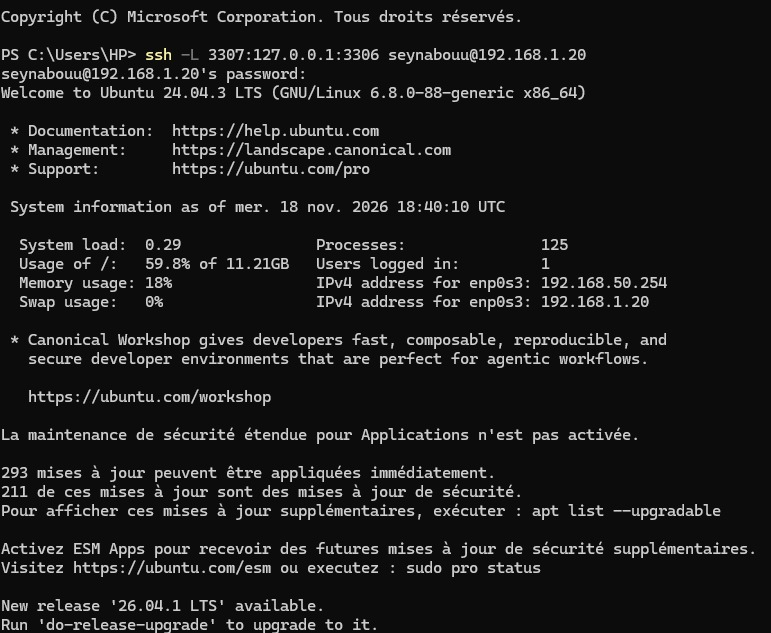</p>
<p align="center"><i>Figure 12 – Ouverture du tunnel SSH vers MariaDB (3307 → 3306)</i></p>

**Connexion à la base via le tunnel.** Dans un second terminal du client, on se connecte au port local 3307 :

```powershell
mysql -h 127.0.0.1 -P 3307 -u tp -p
```
```sql
SHOW DATABASES;
```

<p align="center">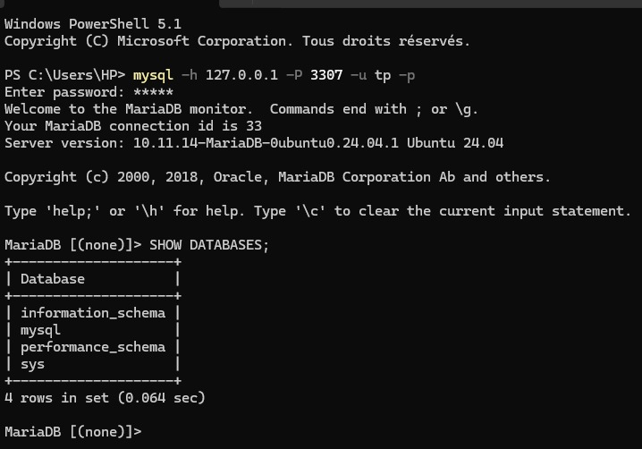</p>
<p align="center"><i>Figure 13 – Connexion à MariaDB depuis le client à travers le tunnel</i></p>

Le client se connecte au serveur MariaDB 10.11.14 et `SHOW DATABASES` liste les bases du serveur (`information_schema`, `mysql`, `performance_schema`, `sys`).

> **💡 Intérêt du tunnel**
> Par défaut, MariaDB n'écoute que sur l'interface locale `127.0.0.1` du serveur : elle n'est donc pas joignable directement depuis le réseau. Grâce au tunnel, le client y accède comme s'il était local, sans ouvrir le port 3306 sur le réseau et avec des échanges entièrement chiffrés. Seul le port 22 a besoin d'être autorisé.

---

## 7. Conclusion

Ce TP a permis de mettre en œuvre les principales fonctionnalités du protocole SSH :

- ✅ l'installation, l'activation et la vérification d'un serveur OpenSSH sur Ubuntu ;
- ✅ la connexion à distance depuis un client Windows, avec vérification de l'empreinte du serveur ;
- ✅ la génération d'une paire de clés RSA et le transfert de la clé publique, base de l'authentification sans mot de passe ;
- ✅ la création de tunnels SSH donnant un accès chiffré à un serveur web Apache (port 1024 → 80) et à une base MariaDB (port 3307 → 3306).

SSH s'impose ainsi comme un outil essentiel de l'administration système : il sécurise l'accès distant, simplifie l'authentification grâce aux clés et protège des services qui ne sont pas chiffrés à l'origine, tout en limitant les ports exposés sur le réseau.

---

<div align="center">
<sub>ESP / UCAD — L3 GLSI · Services Réseaux Avancés · 2026 – 2027</sub>
</div>
